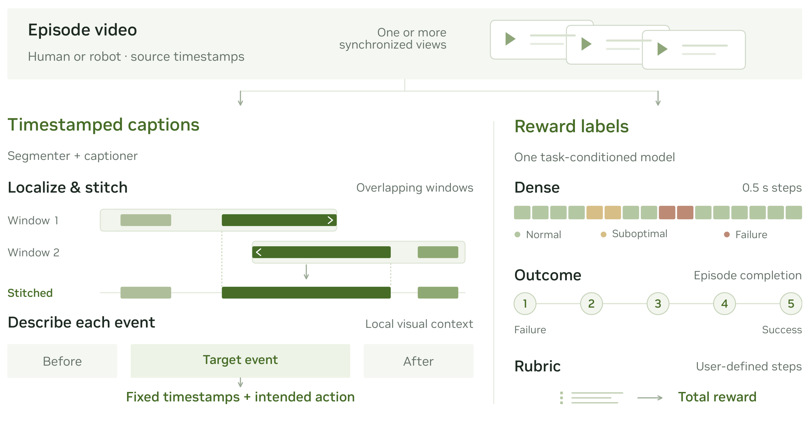
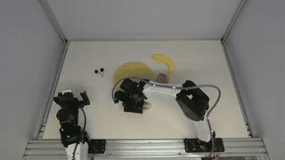
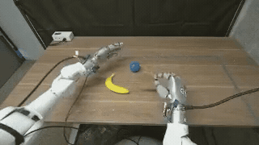
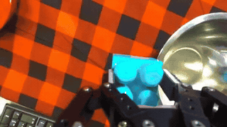
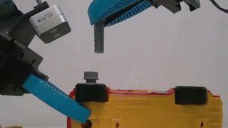
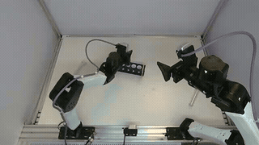
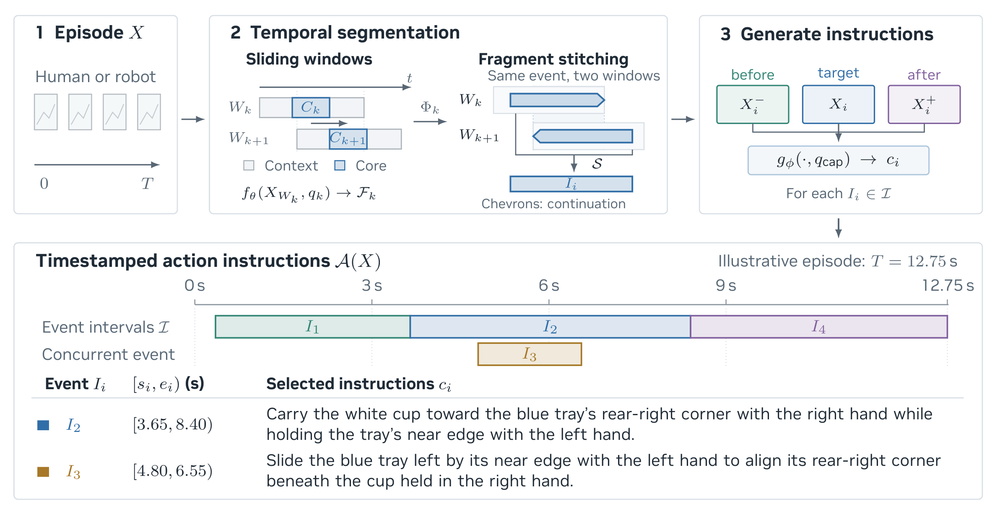
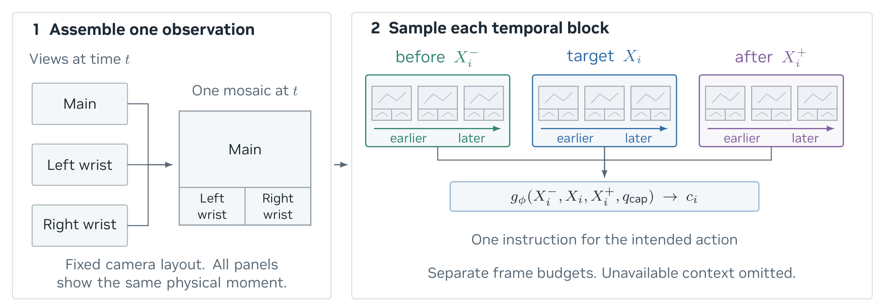
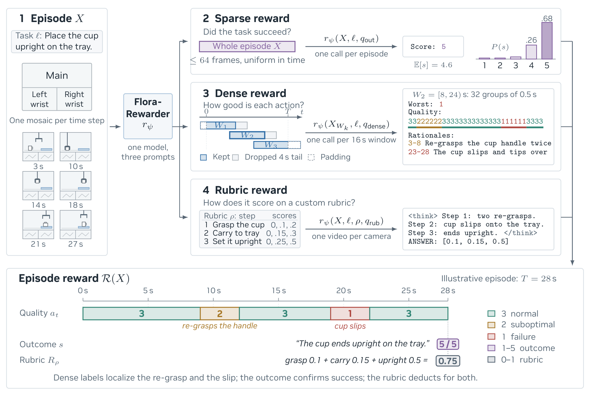

<div align="center">

# FLORA

### An Open Model Suite for Scaling Robotics Data Engines

[Project Page](https://research.nvidia.com/labs/gear/flora/) &nbsp;·&nbsp;
[Paper](https://research.nvidia.com/labs/gear/flora/assets/paper/flora.pdf) &nbsp;·&nbsp;
[Weights](https://huggingface.co/collections/nvidia/flora) &nbsp;·&nbsp;
[Examples](#examples) &nbsp;·&nbsp;
[Method](#method) &nbsp;·&nbsp;
[Action Annotation](#action-annotation) &nbsp;·&nbsp;
[Reward Scoring](#reward-scoring)

</div>

FLORA turns manipulation videos into annotations for robot learning:
**when an action happens, what the action is, and how well it is performed.**
Temporal segmentation and contextual captioning produce timestamped action
instructions. The rewarder provides episode-level outcome scores, dense action
quality, and scores for user-defined rubric steps.

<a href="assets/readme/figure-7.png"></a>

*From video to reusable supervision — [Figure 7 in the paper](https://research.nvidia.com/labs/gear/flora/assets/paper/flora.pdf#page=8).*

## Examples

These examples reuse predictions and short video excerpts from the
[FLORA project page](https://research.nvidia.com/labs/gear/flora/).
The loops show excerpts; outcome and rubric scores describe the full episodes.

### Timestamped action captions

<table>
<tr>
<th width="33%">Human video</th>
<th width="33%">Parallel grippers</th>
<th width="33%">Dexterous hands</th>
</tr>
<tr>
<td><a href="https://research.nvidia.com/labs/gear/flora/#explore"></a></td>
<td><a href="https://research.nvidia.com/labs/gear/flora/#explore"></a></td>
<td><a href="https://research.nvidia.com/labs/gear/flora/#explore"></a></td>
</tr>
<tr valign="top">
<td><b>15.85–37.25 s</b><br>“hold bottle with left hand, scrape glass with utility knife in right hand”</td>
<td><b>8.80–12.80 s</b><br>“Put the cucumber on the plate with the right hand.”</td>
<td><b>11.50–27.73 s</b><br>“Peel the backing from the bandage with the left hand while holding the bandage with the right hand.”</td>
</tr>
</table>

### Outcome, process, and rubric rewards

<table>
<tr>
<th width="33%">Outcome reward</th>
<th width="33%">Process reward</th>
<th width="33%">Rubric reward</th>
</tr>
<tr>
<td><a href="https://research.nvidia.com/labs/gear/flora/#explore"></a></td>
<td><a href="https://research.nvidia.com/labs/gear/flora/#explore"></a></td>
<td><a href="https://research.nvidia.com/labs/gear/flora/#explore"></a></td>
</tr>
<tr valign="top">
<td><b>Success: 5 / 5</b><br>Put the block in the silver bowl.</td>
<td><b>Suboptimal: 2 / 3</b><br>At 37.40–39.90 s: “the gray toy wheel ring is not aligned with the black toy wheel”</td>
<td><b>Total: 1.00 / 1.00</b><br>Four placement steps, each scored 0.25 / 0.25.</td>
</tr>
</table>

## Method

### Localize actions, then describe them

The segmenter processes overlapping windows and stitches their fragments into
episode-level event intervals. Each interval is then captioned independently
using visual context from before, during, and after the event. Concurrent
actions can retain overlapping intervals.

<a href="assets/readme/figure-13.png"></a>

*[Figure 13](https://research.nvidia.com/labs/gear/flora/assets/paper/flora.pdf#page=31): Windowed localization and contextual captioning.*

For multi-camera captioning, synchronized views are tiled into one observation
at each source timestamp. Observations stay in temporal order within the
before, target, and after blocks; unavailable context is omitted.

<a href="assets/readme/figure-14.png"></a>

*[Figure 14](https://research.nvidia.com/labs/gear/flora/assets/paper/flora.pdf#page=31): Synchronized views and temporal context.*

### Score outcomes, local actions, or custom steps

One rewarder supports three interfaces: **outcome** (sparse) rewards score task
completion, **process** (dense) rewards locate good and poor execution over
time, and **rubric** rewards assign credit to user-defined steps.

<a href="assets/readme/figure-15.png"></a>

*[Figure 15](https://research.nvidia.com/labs/gear/flora/assets/paper/flora.pdf#page=36): Three interfaces, one reward model. The timeline and scores are illustrative.*

## Models and Code

**This repository provides sample vanilla inference code for the released
weights, not the production inference system.** The examples are intended
as a straightforward starting point for running and integrating FLORA.

For large-scale workloads, throughput can be improved with optimized inference
frameworks, dynamic batching, asynchronous video decoding and preprocessing,
and queue-based scheduling across persistent GPU workers. These optimizations
are left to downstream deployments; the sample scripts' runtime does not
represent production throughput.

| Component | Purpose | Weights | Inference guide |
|---|---|---|---|
| Temporal segmentation | Locate action intervals | [Flora-TempSeg](https://huggingface.co/nvidia/Flora-TempSeg) | [Segmentation and captioning](tempseg/batch_utils/README.md) |
| Action captioning | Describe each intended operation | [Flora-Captioner](https://huggingface.co/nvidia/Flora-Captioner) | [Segmentation and captioning](captioner/batch_utils/README.md) |
| Reward scoring | Evaluate outcomes, action quality, and rubric steps | [Flora-Rewarder](https://huggingface.co/nvidia/Flora-Rewarder) | [Rewarder](rewarder/batch_utils/README.md) |

Both `tempseg/` and `captioner/` contain the complete segmentation-to-caption
workflow. The annotation examples below use `captioner/`.

## Quick Start

```bash
git clone https://github.com/NVIDIA/Flora.git
cd Flora
```

All commands below run from the repository root. Use your own local videos.
Annotation and reward scoring use separate environments.

## Action Annotation

The validated annotation environment is **Python 3.12 on Linux with a CUDA GPU
and 80 GB of GPU memory**. Reserve at least **150 GB of local storage** for the
weights and cache. The two annotation stages run sequentially.

<details>
<summary><b>Install annotation dependencies</b></summary>

```bash
python3.12 -m venv .venv-annotation
source .venv-annotation/bin/activate
python -m pip install torch==2.11.0 torchvision==0.26.0 --index-url https://download.pytorch.org/whl/cu128
python -m pip install -r captioner/batch_utils/requirements.txt
```

The pipeline downloads the released weights on first use. Set
`FLORA_MODEL_CACHE` to select a cache directory. See the
[inference guide](captioner/batch_utils/README.md) and
[third-party notices](captioner/batch_utils/THIRD_PARTY_NOTICES.md).

</details>

### Human video

```bash
python captioner/infer.py \
  --video videos/human.mp4 \
  --profile human \
  --output annotations/human.json
```

### Robot video

```bash
python captioner/infer.py \
  --video videos/main.mp4 \
  --left-wrist videos/left_wrist.mp4 \
  --right-wrist videos/right_wrist.mp4 \
  --profile yam \
  --output annotations/robot.json
```

Use `--profile dex` for Dex inputs. All three camera streams must have aligned
frame timestamps, frame counts, and durations. The main view is placed above
the left- and right-wrist views. Add `--validate-only` to check the inputs on
CPU without downloading weights or running inference.

### Output

The pipeline returns action intervals in **seconds relative to the input
clip**, caption text, and a completion status. Simplified illustrative output:

```json
{
  "segments": [
    {
      "start_s": 0.8,
      "end_s": 3.2,
      "caption": "Pick up the cup with the right hand.",
      "status": "complete"
    }
  ]
}
```

For multiple videos:

```bash
python captioner/infer.py --input-jsonl jobs.jsonl --output-dir annotations
```

See the [job format and Python usage](captioner/batch_utils/README.md#jsonl-jobs).
Jobs run sequentially; existing outputs are preserved unless `--overwrite` is
supplied.

## Reward Scoring

One rewarder supports three modes:

| Mode | Question | Output |
|---|---|---|
| **Outcome** | Did the episode accomplish the task? | A success score from **1 to 5**, with score probabilities and an expected score |
| **Process** | How well was each local action performed? | A timeline of **1: failure**, **2: suboptimal**, or **3: normal**, with explanations for non-normal spans |
| **Rubric** | Which task-specific steps were completed? | A score for each step in a user-supplied rubric |

The validated reward environment uses **Python 3.12 and NVIDIA H100 80 GB
GPUs**: one GPU for outcome or process scoring, and two GPUs for the default
rubric configuration. See the [rewarder guide](rewarder/batch_utils/README.md)
for complete input and output specifications.

<details>
<summary><b>Install rewarder dependencies</b></summary>

```bash
python3.12 -m venv .venv-rewarder
source .venv-rewarder/bin/activate
python -m pip install -r rewarder/batch_utils/requirements.txt
```

Weights are downloaded from the repository selected by `--model`. Review the
[rewarder third-party notices](rewarder/batch_utils/THIRD_PARTY_NOTICES.md).

</details>

### Score an episode

Provide the task instruction and synchronized camera videos. For the
three-camera outcome/process examples, the order is **left wrist, main,
right wrist**:

```bash
python -m rewarder.batch_utils.terminal_reward \
  --model nvidia/Flora-Rewarder \
  --video videos/left_wrist.mp4 videos/main.mp4 videos/right_wrist.mp4 \
  --task "Put the cup on the tray." \
  --output rewards/outcome.jsonl
```

### Score action quality over time

```bash
python -m rewarder.batch_utils.dense_reward \
  --model nvidia/Flora-Rewarder \
  --video videos/left_wrist.mp4 videos/main.mp4 videos/right_wrist.mp4 \
  --task "Put the cup on the tray." \
  --output rewards/process.jsonl
```

Process scores are retrospective and can use later frames in a clip; use them
for offline analysis and labeling.

### Score a task-specific rubric

Create `rubric_jobs.jsonl` with the camera descriptions, task, and scored steps
in the [rubric job format](rewarder/batch_utils/README.md#rubric-reward), then run:

```bash
python -m rewarder.batch_utils.rubric_reward \
  --model nvidia/Flora-Rewarder \
  --jobs rubric_jobs.jsonl \
  --output rewards/rubric.jsonl
```

Rubric camera descriptions must match the order of the supplied videos.
For processing multiple episodes, all three reward commands also accept
`--jobs` with a JSONL file.

## License

This repository is governed by the [NVIDIA License](LICENSE) for non-commercial
research and evaluation. Refer to each weight repository for its model terms
and to the linked third-party notices for dependency licenses.

## Citation

Sicong Leng et al. **FLORA: An Open Model Suite for Scaling Robotics Data
Engines.** 2026. [Paper](https://research.nvidia.com/labs/gear/flora/assets/paper/flora.pdf).

If you use FLORA in your research, please cite the paper using the
[BibTeX entry from the project page](https://research.nvidia.com/labs/gear/flora/#bibtex):

```bibtex
@article{leng2026flora,
  title   = {Flora: An Open Model Suite for Scaling Robotics Data Engines},
  author  = {Sicong Leng and Yunze Man and Zhiqi Li and Jing Wang and
             Yuhe Zhang and Ryan Punamiya and Siddharth Patki and Kaiyuan Zheng and
             Zi-ang Cao and Zhiding Yu and Sifei Liu and Danfei Xu and Ben Levin and
             Jan Kautz and Yuke Zhu and Johan Bjorck and Linxi "Jim" Fan},
  year    = {2026}
}
```
